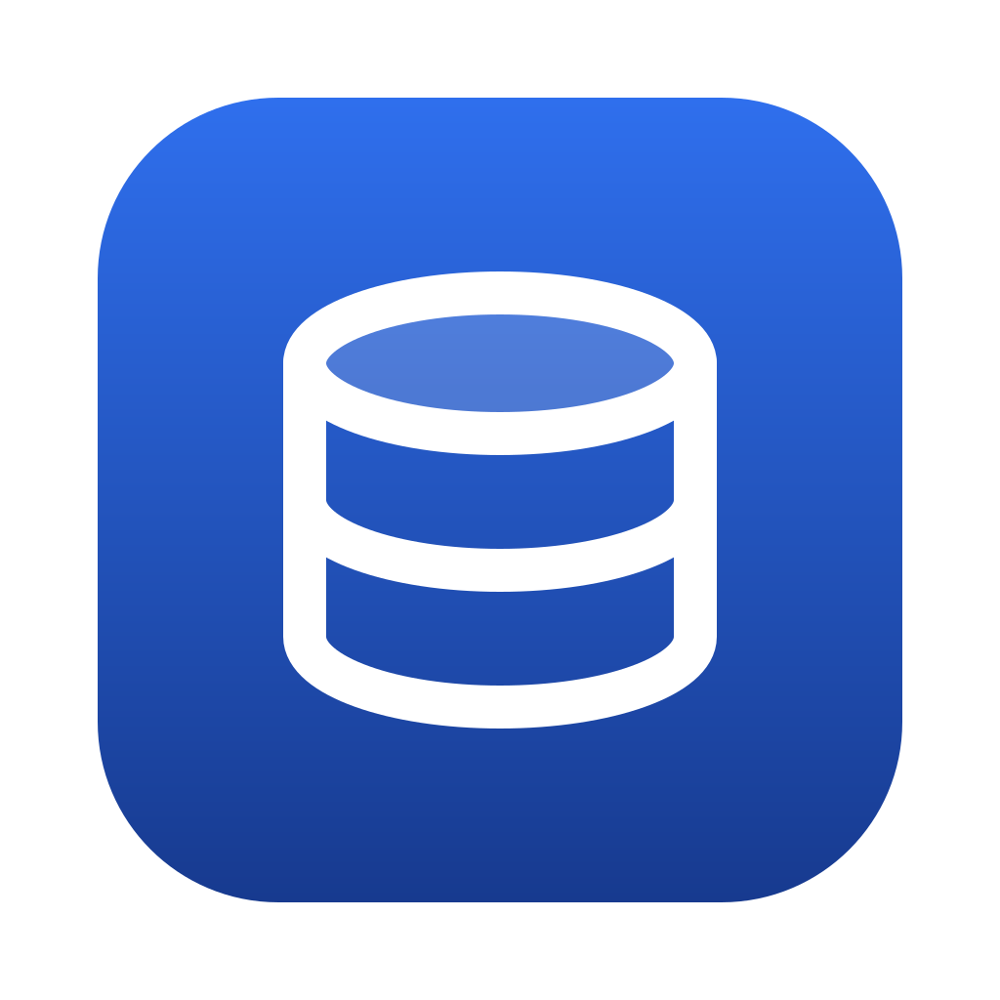
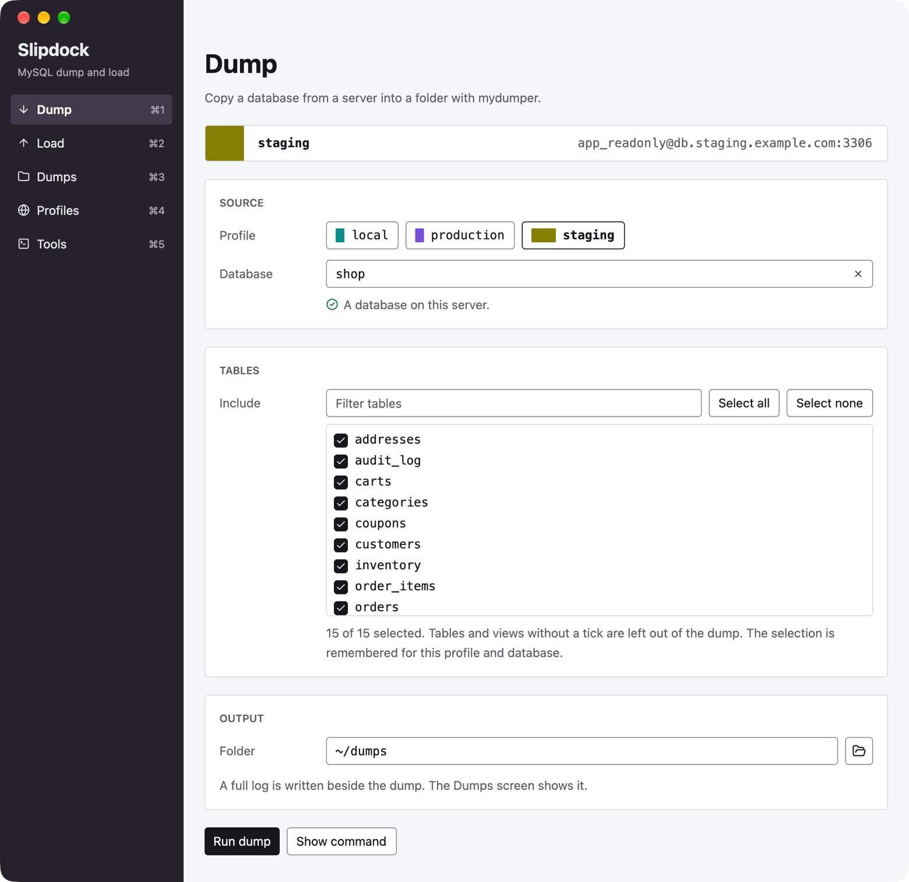
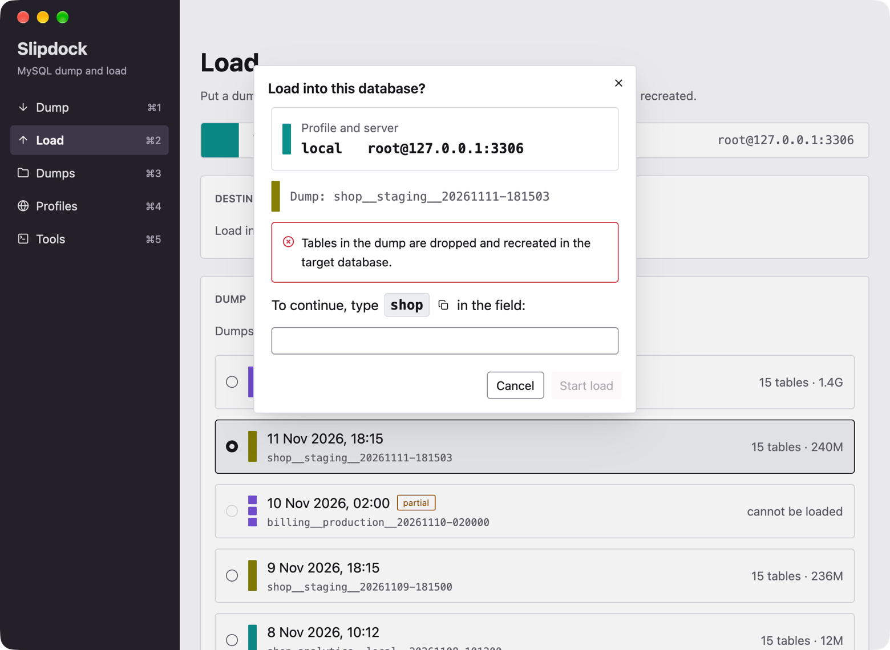
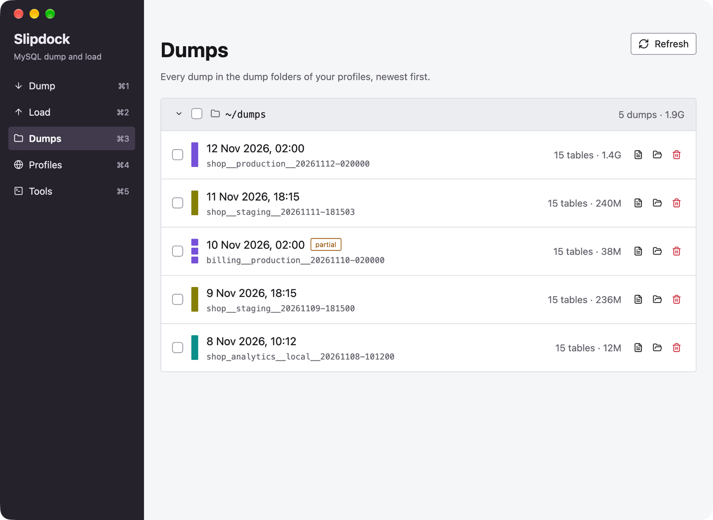
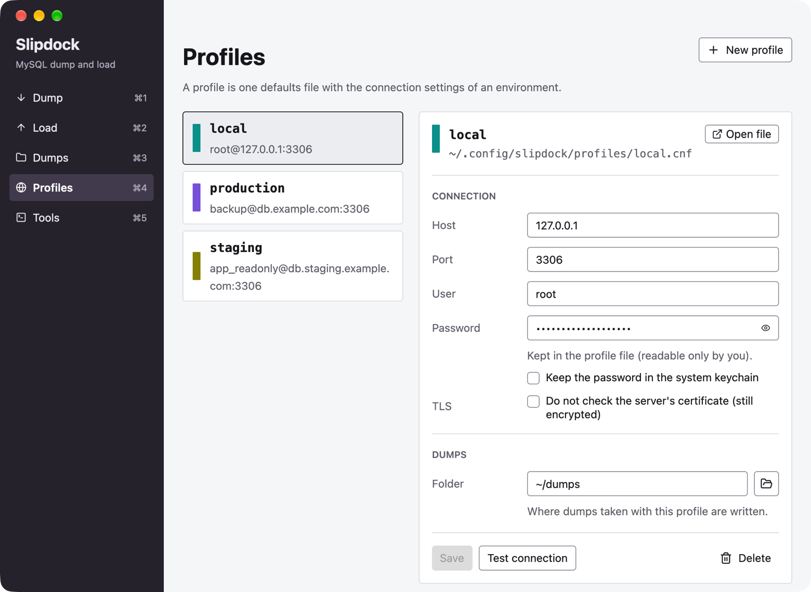

<div align="center">
  
  <h1>Slipdock</h1>
  <p>
    Dump and load MySQL and MariaDB databases with
    <a href="https://github.com/mydumper/mydumper">mydumper</a>,<br>
    from a desktop app or the command line.
  </p>
  <p>
    <a href="#install">Install</a> ·
    <a href="#quick-start">Quick start</a> ·
    <a href="#commands">Commands</a> ·
    <a href="docs/reference.md">Reference</a> ·
    <a href="docs/development.md">Development</a>
  </p>
</div>

Slipdock is a desktop app and a command line tool for copying MySQL and
MariaDB databases. You take a dump of a database, keep it, and load it into
another one: to refresh a development database from staging, to keep
backups, or to move a database to another server.

The work itself is done by mydumper and myloader, which are fast but take
many options. Slipdock keeps one connection file per environment, builds the
command for you, shows the progress, and tells you at the end whether the
dump or load is complete.

<p align="center">
  
</p>

<table>
  <tr>
    <td width="33%"></td>
    <td width="33%"></td>
    <td width="33%"></td>
  </tr>
  <tr>
    <td align="center">The guard before a load</td>
    <td align="center">Every dump, with its profile's colour</td>
    <td align="center">One profile per environment</td>
  </tr>
</table>

<p align="center"><sub>The screenshots show example data.</sub></p>

## Features

- **One profile per environment.** A profile is a normal MySQL defaults file,
  so mydumper, myloader and the mysql client read it as it is.
- **No hidden commands.** Slipdock shows the exact command before it runs, and
  `--dry-run` stops there.
- **A guard on every load.** Before a load you type the name of the database
  that is about to be overwritten. There is no `--yes`.
- **An honest result.** A dump is judged by its `metadata` file, not by the
  exit code, so a complete dump with a warning is not reported as failed.
- **Passwords where you want them.** In the profile file, or in the system
  keychain.
- **Two front ends, one behaviour.** The `slipdock` command and the desktop
  app share one library and print the same reports.

## Install

### Desktop app (macOS, Apple Silicon)

Download `Slipdock-macos-arm64.zip` from the
[Releases page](https://github.com/coziboy/slipdock/releases), unzip it and move
`Slipdock.app` to `/Applications`.

The app is not notarized by Apple, so macOS blocks it the first time. Do one
of these once:

- Open the app and close the warning. Then go to **System Settings > Privacy &
  Security**, scroll to **Security** and click **Open Anyway**.
- Or remove the download flag in a terminal:

  ```sh
  xattr -dr com.apple.quarantine /Applications/Slipdock.app
  ```

### From source (macOS, Linux)

You need [rustup](https://rustup.rs); it fetches the pinned compiler on the
first build.

```sh
cargo build --release
# target/release/slipdock and target/release/slipdock-app
```

An app you build yourself is never blocked by macOS. To make `Slipdock.app`
from source, see [Development](docs/development.md#macos-app-bundle). On
Windows, use Slipdock inside WSL.

### Requirements

Slipdock never downloads these tools. It finds what is installed, and
`slipdock tools install` shows the install command for your package manager.

| Tool | Needed for | Version |
| --- | --- | --- |
| mydumper, myloader | dumping and loading | 0.20.1 or newer (tested with 1.0.19) |
| zstd | compressing dumps | any |
| mysql or mariadb client | optional: lists databases and tables to pick from | any |

- **macOS:** `brew install mydumper mysql-client`
- **Linux:** take the `.deb` or `.rpm` from mydumper's
  [releases](https://github.com/mydumper/mydumper/releases). Distribution
  repositories ship 0.10 or nothing. Installing needs root, so Slipdock shows
  the steps and does not run them.

## Quick start

```sh
slipdock init staging            # creates a profile from the template
# edit the file it printed: host, user, password, dump-dir
slipdock dump staging shop --dry-run
slipdock dump staging shop
slipdock dumps staging
slipdock load local ~/dumps/shop__staging__20260102-030405
```

Or run `slipdock` alone on a terminal for guided mode: it asks for the
profile, database and tables, shows the command it is about to run, and offers
a dry run.

To use the desktop app, start `Slipdock.app`, or run `slipdock app` from a
source build. It has five screens: **Dump**, **Load**, **Dumps**,
**Profiles** and **Tools**.

## Commands

```text
slipdock                                   guided mode on a terminal, help otherwise
slipdock init <profile>
slipdock profiles
slipdock dump <profile> <db> [-x, --exclude t1,t2]... [--out DIR] [--log-level 0-3] [-- mydumper args]
slipdock load <profile> <dump-dir> [target-db] [--log-level 0-3] [--confirm NAME] [-- myloader args]
slipdock dumps [profile]
slipdock tools
slipdock tools install [tool]
slipdock tools set <tool> <path> | unset <tool>    # tool: mydumper, myloader, mysql, zstd
slipdock password set|clear <profile>
slipdock completions zsh|bash|fish
slipdock app
```

On `dump` and `load`: `--dry-run` shows the command and stops,
`--show-command` shows it and runs. Everywhere: `--config-dir DIR` and
`--color auto|always|never` (`auto` honours `NO_COLOR`).

## Documentation

- [Reference](docs/reference.md): the load guard, how a dump is judged, the
  config folder and profile keys, passwords, and notes on the app.
- [Development](docs/development.md): build, run from source, code layout,
  tests and releases.

## License

MIT or Apache-2.0, at your option. See [LICENSE-MIT](LICENSE-MIT) and
[LICENSE-APACHE](LICENSE-APACHE).
